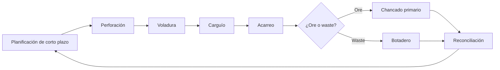

# Digital Mine — Alcance del MVP

> Este documento es un PRD ligero / definición de alcance del MVP. La especificación de requisitos está en [04-srs.md](04-srs.md).

> Proyecto en preparación. Este documento describe el MVP propuesto; la implementación está pendiente.

## 1. Objetivo

Construir un gemelo digital que refleje con datos el ciclo de operación de una mina a cielo abierto, desde la planificación de corto plazo hasta la alimentación del chancado primario, permitiendo:

- Observar el estado actual de la operación.
- Reconstruir lo ocurrido en un turno (replay).
- Comparar lo planificado contra lo ejecutado.
- Visualizar el flujo de datos entre los sistemas que alimentan el gemelo.

El MVP utiliza datos sintéticos. La arquitectura deja preparada la conexión a fuentes reales.

## 2. Ciclo operacional incluido

| Etapa | Qué modela el MVP | Nivel de detalle |
|---|---|---|
| Planificación de corto plazo | Plan de turno, frentes de carguío, metas por destino y asignación de flota | Formulario simple + datos semilla |
| Perforación | Patrones, metros perforados y estado del frente | Eventos de inicio/fin; no se simula la máquina en detalle |
| Voladura | Evento de tronadura, tonelaje estimado y liberación del frente | Evento |
| Carguío | Ciclos de pala, colas, tiempos y carga de camiones | Simulado |
| Acarreo | Rutas, posición, velocidad, carga, destino y ciclos | Simulado a 1 Hz |
| Descarga | Clasificación ore/waste y destino (chancado o botadero) | Evento |
| Chancado primario | Alimentación, throughput, nivel de tolva, estado y paradas | Simulado |
| Reconciliación | Plan vs. real por turno, frente y destino; KPIs | Calculado |

## 3. Dentro del MVP

- **Modelo de actores y activos:** roles humanos, sistemas fuente, equipos, frentes, rutas, destinos y chancador.
- **Simulador sintético:** genera un turno completo con flota, rutas, colas, cargas, botadero, chancado y eventos de perforación/voladura.
- **Ingesta en tiempo real:** bus de eventos MQTT, validación de esquemas y persistencia.
- **Estado vivo del gemelo:** posición y estado de equipos, estado del chancador, avance del plan y salud de las fuentes.
- **Mapa operacional 2D/2.5D:** tajo, bancos, rutas, frentes, botadero, chancador y equipos en movimiento.
- **Tablero de operación:** flota, ciclos, colas, tonelaje, utilización y estado del chancador.
- **Tablero de chancado:** alimentación, throughput, tolva, disponibilidad y paradas.
- **Plan vs. real:** cumplimiento por turno, frente y destino.
- **Replay:** reconstrucción de un turno con controles de tiempo.
- **Vista de flujo de datos:** topología de fuentes, mensajes por segundo, última señal, latencia y errores.
- **Alertas básicas:** chancador detenido, camión inactivo, fuente de datos sin señal y desvío relevante del plan.

## 4. Fuera del MVP

- Geología, modelo de bloques, leyes, dilución y clasificación fina de mineral.
- Geotecnia, ambiente, seguridad y salud ocupacional.
- Gestión de mantenimiento: solo se usa el estado operativo del equipo, no órdenes de trabajo.
- Planta downstream: molienda, concentración, relaves y despacho de producto.
- Logística externa, ferrocarril, puerto y comercialización.
- Integración real con FMS/SCADA propietarios: se define la interfaz, pero el MVP usa simulador.
- Optimización automática del despacho o control de equipos reales.
- Gemelo 3D fotorrealista. El MVP parte con mapa 2D/2.5D.
- Multiusuario avanzado, SSO, multi-sitio y aplicación móvil.
- Cumplimiento regulatorio y auditoría formal.

## 5. Actores

### 5.1 Actores humanos

| Actor | Responsabilidad | Qué necesita ver o hacer |
|---|---|---|
| Planificador de corto plazo | Define el plan de turno, frentes, metas y destinos | Crear/ajustar el plan y revisar su cumplimiento |
| Ingeniero de perforación y voladura | Define patrones y ventanas de tronadura | Estado de perforación, eventos de voladura y liberación de frentes |
| Despachador | Asigna y monitorea la flota | Mapa, estados, colas y alertas; reasignación manual como mejora posterior |
| Operador de equipo | Ejecuta la operación | Instrucción y estado; en el MVP la operación es simulada |
| Operador de chancado | Opera el chancador primario | Alimentación, tolva, throughput y paradas |
| Supervisor de turno | Controla la ejecución del turno | KPIs, alertas y plan vs. real |
| Gerencia de operaciones | Evalúa el desempeño | Tendencias, cumplimiento y reportes |
| TI/OT | Monitorea integraciones | Salud y flujo de datos |

### 5.2 Actores técnicos (sistemas)

| Sistema | Datos que aporta | Medio en el MVP |
|---|---|---|
| Simulador de mina | Telemetría, eventos y plan ejecutado | MQTT (sintético) |
| FMS / despacho | Asignaciones y estado de flota | Adaptador futuro |
| GPS / telemetría de equipos | Posición, velocidad, motor, carga y combustible | MQTT 1 Hz |
| Sistema de perforación | Patrones y metros perforados | Eventos |
| Sistema de voladura | Eventos de tronadura | Eventos |
| Báscula / sensor de carga | Tonelaje por ciclo | Eventos |
| SCADA / PLC de chancado | Alimentación, throughput, tolva y estado | MQTT simulado; OPC UA futuro |
| Planificador | Plan de turno | API/JSON |
| Gemelo digital | Estado, histórico, KPIs y alertas | API + WebSocket |

## 6. Supuestos del MVP

- Un sitio, un tajo, un chancador primario y un botadero.
- Flota base: 2 palas, 6 camiones y 1 perforadora (configurable).
- No se modela stockpile ROM intermedio: el ore descargado alimenta directamente al chancador.
- No se modela calidad, ley ni mezcla de materiales; solo tonelaje y clasificación ore/waste.
- Turnos de 8 horas; la simulación puede acelerar el tiempo (por defecto, 1 segundo real = 1 minuto simulado).
- Telemetría de equipos a 1 Hz; eventos operacionales inmediatos.
- Actualización de la interfaz en menos de 5 segundos.
- Datos sintéticos reproducibles mediante semilla.
- Mapa 2D/2.5D; la vista 3D se evalúa después del MVP.
- Interfaz en español, unidades métricas y almacenamiento de tiempos en UTC.
- MVP local, sin autenticación; no se expone a internet.
- El gemelo observa y simula; no comanda equipos reales.

## 7. Criterios de aceptación

1. El entorno levanta con un comando documentado (Docker + `pnpm dev`).
2. El simulador genera un turno completo con ore/waste, perforación, voladura, carguío, acarreo y chancado.
3. El mapa muestra equipos en movimiento y su estado con actualización casi en tiempo real.
4. El tablero de chancado muestra alimentación, throughput, tolva y paradas.
5. El tablero de plan vs. real calcula cumplimiento por turno, frente y destino.
6. La vista de flujo de datos muestra fuentes, mensajes por segundo, última señal y errores.
7. El replay reconstruye un turno con controles de tiempo.
8. Existen pruebas unitarias del dominio y al menos una prueba end-to-end.
9. La ejecución con la misma semilla produce el mismo turno.
10. El alcance y la arquitectura están documentados y son reproducibles.

## 8. Glosario

- **Frente de carguío:** zona donde una pala carga camiones.
- **Banco:** nivel horizontal de excavación en el tajo.
- **ROM:** mineral bruto que alimenta el chancador.
- **Botadero:** destino del material estéril (waste).
- **Chancado primario:** primera reducción de tamaño del mineral; límite de este MVP.
- **Throughput:** toneladas por hora procesadas por el chancador.
- **Ciclo:** secuencia carguío → acarreo → descarga → retorno.
- **Reconciliación:** comparación entre lo planificado y lo ejecutado.
- **FMS:** Fleet Management System.
- **SCADA:** sistema de control y supervisión industrial.
- **MQTT:** protocolo ligero de mensajería para telemetría.
