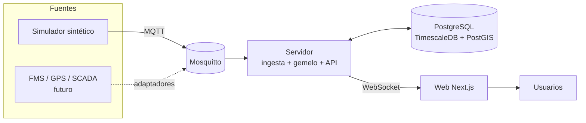

# Digital Mine — Arquitectura propuesta del MVP

> Proyecto en preparación. Este documento describe el MVP propuesto; la implementación está pendiente.

## 1. Principios

- **Monolito modular antes que microservicios.** El MVP tiene un servidor con módulos de ingesta, gemelo, API y WebSocket. El simulador es un proceso aparte.
- **Event-driven.** Los cambios de la operación se expresan como eventos; las consultas se resuelven con proyecciones.
- **Adaptadores reemplazables.** El simulador y las fuentes reales implementan las mismas interfaces.
- **Simulador determinista.** La misma semilla produce el mismo turno.
- **Tiempo simulado explícito.** La UI distingue hora simulada de hora real.
- **Local-first.** Todo corre en Docker Compose para desarrollo y demo.
- **Sin sobre-ingeniería.** Sin Kafka, Kubernetes ni microservicios en el MVP.

## 2. Vista de contexto



## 3. Componentes

| Componente | Responsabilidad |
|---|---|
| `apps/web` | Interfaz Next.js: mapa, tableros, plan, replay y flujo de datos |
| `apps/server` | Fastify: ingesta MQTT, estado del gemelo, API REST, WebSocket y reconciliación |
| `apps/simulator` | Genera el turno sintético y publica telemetría/eventos |
| `packages/domain` | Entidades, tipos de evento, máquinas de estado, fórmulas de KPI y validaciones |
| `packages/db` | Esquema, migraciones y repositorios |
| `infra` | Docker Compose, configuración de Mosquitto y variables de entorno |
| `docs` | Alcance, arquitectura, backlog y decisiones |

### 3.1 Módulos internos de `apps/server`

- **Ingesta:** suscripción MQTT, validación con Zod, deduplicación y persistencia.
- **Gemelo:** estado en memoria, proyección de ciclos, cálculo de KPIs y alertas.
- **API:** consultas de estado, histórico, plan, KPIs y salud de fuentes.
- **WebSocket:** snapshot inicial y deltas en vivo.
- **Reconciliación:** cierre de turno y comparación plan vs. real.

## 4. Flujo de datos

1. El planificador crea o ajusta un plan de turno en la web.
2. La API valida el plan, lo guarda y publica `plan.published`.
3. El simulador consume el plan y genera la operación del turno.
4. El simulador publica telemetría y eventos en MQTT.
5. El servidor valida, deduplica, persiste y actualiza el estado del gemelo.
6. El servidor envía deltas por WebSocket a la web.
7. La web actualiza mapa, flota, chancado, KPIs y flujo de datos.
8. Al cierre del turno, la reconciliación calcula cumplimiento y alimenta el siguiente plan.
9. El replay reconstruye cualquier ventana desde el histórico.

## 5. Modelo de eventos

### 5.1 Sobre (envelope)

```ts
export interface DomainEvent<T> {
  eventId: string;          // UUID
  eventType: string;        // equipment.telemetry, truck.loaded, crusher.downtime...
  eventVersion: 1;
  occurredAt: string;       // ISO 8601, hora simulada o real del hecho
  sentAt: string;           // ISO 8601, hora real de publicación
  siteId: string;
  source: string;           // simulator, fms, scada
  correlationId?: string;
  simulated: boolean;
  payload: T;
}
```

### 5.2 Tópicos MQTT

- `mine/{siteId}/plan`
- `mine/{siteId}/telemetry/equipment/{equipmentId}`
- `mine/{siteId}/telemetry/crusher`
- `mine/{siteId}/events/{eventType}`
- `mine/{siteId}/health/{sourceId}`

Calidad de servicio: QoS 1. Para el MVP, un solo sitio.

### 5.3 Eventos principales

- `plan.published`, `shift.started`, `shift.ended`
- `equipment.telemetry`, `equipment.status_changed`
- `drill.pattern_completed`
- `blast.detonated`
- `truck.queued`, `truck.loading_started`, `truck.loaded`
- `truck.hauling_started`, `truck.dumped`, `truck.returning`
- `crusher.telemetry`
- `crusher.downtime_started`, `crusher.downtime_ended`
- `kpi.snapshot`
- `alert.raised`, `alert.cleared`
- `data_source.health`

### 5.4 Máquinas de estado

- **Camión:** `idle → queued → loading → hauling → dumping → returning → idle`; `down` desde cualquier estado.
- **Pala:** `idle → loading → waiting → idle`; `down`.
- **Perforadora:** `idle → moving → drilling → idle`; `down`.
- **Chancador:** `running → stopped` y `running → blocked`; `maintenance`.

Las transiciones viven en `packages/domain` y se prueban de forma unitaria.

## 6. Modelo de datos

| Tabla | Propósito | Notas |
|---|---|---|
| `sites` | Sitio y configuración general | Un registro en el MVP |
| `benches` | Bancos del tajo | Geometría simple |
| `dig_units` | Frentes de carguío | Polígono, banco, material |
| `destinations` | Chancador y botadero | Tipo y capacidad |
| `roads` | Grafo de rutas | Nodos y segmentos |
| `equipment` | Equipos y chancador | Tipo, capacidad, estado |
| `operators` | Operadores | Solo referencia en el MVP |
| `shifts` | Turnos | Inicio, fin, estado |
| `plans` / `plan_targets` | Plan de turno y metas | Por frente y destino |
| `assignments` | Asignación camión–pala | Por turno |
| `telemetry` | Series temporales de equipos | Hypertable TimescaleDB |
| `events` | Eventos de dominio | `payload jsonb`, índice por tiempo y tipo |
| `cycles` | Proyección de ciclos | Derivada de eventos |
| `crusher_samples` | Series del chancador | Hypertable |
| `kpi_snapshots` | KPIs por turno/periodo | Reconciliación |
| `data_sources` | Estado de fuentes | Última señal, errores, lag |
| `data_flow_metrics` | Métricas del pipeline | Mensajes/s, latencia, errores |
| `alerts` | Alertas activas e históricas | Reglas simples |

Convenciones: UUID como clave, `timestamptz` en UTC, `jsonb` para payloads variables y nombres en `snake_case`.

## 7. Stack propuesto

| Capa | Tecnología | Motivo |
|---|---|---|
| Lenguaje | TypeScript estricto | Un solo lenguaje en web, servidor y simulador |
| Monorepo | pnpm + Turborepo | Paquetes compartidos y tareas incrementales |
| Web | Next.js + React + Tailwind + shadcn/ui | Desarrollo rápido de tableros |
| Mapa | MapLibre GL JS (2D/2.5D) | Control de capas y geometrías; sin dependencia de mapas de pago |
| Flujo de datos | React Flow | Topología interactiva del pipeline |
| Gráficos | Recharts | KPIs y series temporales |
| Servidor | Fastify + `@fastify/websocket` | Ligero, tipado y rápido |
| Mensajería | MQTT.js + Eclipse Mosquitto | Protocolo estándar de telemetría industrial |
| Base de datos | PostgreSQL + TimescaleDB + PostGIS | Series temporales, geometrías y datos relacionales |
| ORM | Drizzle | Migraciones SQL explícitas y buen tipado |
| Validación | Zod | Esquemas compartidos entre ingesta y API |
| Logs | pino | Logs estructurados |
| Pruebas | Vitest + Playwright | Unidad, integración y end-to-end |
| Calidad | Biome + TypeScript strict | Formato y lint rápidos |
| Infra local | Docker Compose | Reproducibilidad |

> Stack propuesto, sujeto a confirmación. No se implementa hasta cerrar los supuestos del alcance.

## 8. Despliegue local

```text
docker compose up -d        # PostgreSQL/TimescaleDB + Mosquitto
pnpm install
pnpm dev                    # web + server + simulator
```

Servicios de Compose:

- `postgres` (TimescaleDB + PostGIS).
- `mosquitto`.
- Opcional: `web`, `server` y `simulator` en modo producción para la demo.

## 9. Requisitos no funcionales

- **Latencia:** p95 menor a 2 s desde la publicación MQTT hasta la UI en local.
- **Throughput:** 100 mensajes/s sostenidos y 1 000/s en ráfaga para el MVP.
- **Retención:** 7 días de telemetría y 30 días de eventos (configurable).
- **Determinismo:** misma semilla y configuración ⇒ mismo turno.
- **Recuperación:** al reiniciar el servidor, el estado se reconstruye desde la base.
- **Seguridad:** MVP local sin autenticación; no exponer a internet. El diseño deja espacio para OIDC/RBAC.
- **Tiempo:** almacenamiento en UTC; visualización en la zona del navegador y reloj simulado visible.

## 10. Decisiones de arquitectura (ADR)

| ID | Decisión | Motivo |
|---|---|---|
| ADR-001 | Monolito modular | Menos complejidad operativa para un MVP |
| ADR-002 | MQTT para telemetría y WebSocket para la UI | Separar ingestión industrial de consumo web |
| ADR-003 | PostgreSQL + TimescaleDB + PostGIS | Un solo motor para relacional, series y geometría |
| ADR-004 | Simulador primero, adaptadores después | Permite construir y demostrar sin depender de sistemas propietarios |
| ADR-005 | Mapa 2D/2.5D antes que 3D | Menor costo y suficiente para cerrar el ciclo |
| ADR-006 | Sin autenticación en el MVP | Reduce alcance; se agrega antes de exponer el sistema |
| ADR-007 | Eventos versionados con Zod | Contratos explícitos y validación en la frontera |

## 11. Evolución a datos reales

- Interfaz `TelemetrySource` para FMS, GPS y telemetría de equipos.
- Interfaz `PlantSource` para SCADA/PLC del chancador (OPC UA).
- Interfaz `PlanSource` para planes de mina (archivos o API).
- Evaluar ISO 15143-3 (AEMP) para flotas mixtas y MQTT Sparkplug B para plantas.
- Buffer en el borde para conectividad intermitente.
- Autenticación OIDC, RBAC, auditoría y segregación de redes IT/OT.

## 12. Riesgos

| Riesgo | Mitigación |
|---|---|
| Crecimiento descontrolado del alcance | Lista explícita de fuera de alcance y fases del backlog |
| Datos sintéticos poco realistas | Reglas operativas, parámetros configurables y validación con el usuario |
| Confusión entre tiempo real y simulado | Reloj simulado visible y campo `simulated` en los eventos |
| Expectativa de 3D | Mapa 2D/2.5D en el MVP; evaluar 3D después |
| Integración con sistemas propietarios | Adaptadores e interfaces; no bloquear el MVP |
| Volumen de datos | TimescaleDB, retención configurable y agregaciones |
