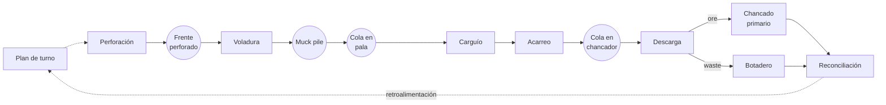

# Digital Mine — Mapa de flujo de valor (VSM)

| Versión | Fecha | Estado | Base |
|---|---|---|---|
| 0.1 | 22 de octubre de 2026 | Borrador para revisión | Documentos 01 a 05 |

> Este documento analiza el flujo de valor del MVP. No es un diagrama C4, no define requisitos y no reemplaza el [alcance del MVP](01-alcance-mvp.md), la [arquitectura propuesta](02-arquitectura.md), el [backlog](03-backlog.md) ni el [SRS](04-srs.md). El método acordado es VSM + DDD-lite; aquí se desarrolla solo el VSM. El estado del proyecto y las decisiones están en [05-decisiones.md](05-decisiones.md).

## 1. Propósito, alcance y método

El VSM (*Value Stream Mapping*) es una técnica de Lean que representa cómo avanzan el material y la información desde un proveedor hasta un cliente, y hace visibles las actividades que transforman el producto, las que son necesarias pero no lo transforman y las esperas o colas entre etapas.

En este proyecto el VSM se usa para fijar el cliente y los límites del MVP, describir cada etapa y su aporte, identificar esperas y candidatos a cuello de botella, derivar los datos que deben capturarse y contrastar el estado actual con el estado futuro que habilitaría el gemelo.

El VSM **no es un diagrama C4**: C4 describe componentes de software y el VSM describe el proceso operativo y su información. Tampoco es un BPMN, un modelo de dominio ni un documento de requisitos. La arquitectura, el alcance, el backlog y el SRS se tratan en sus propios documentos.

El análisis es documental. No hubo observación en terreno, entrevistas ni medición de tiempos; no hay una mina real asociada al proyecto, implementación ejecutable ni datos sintéticos generados. Por eso el VSM es una **hipótesis de proceso**: sirve para acordar qué observar y qué capturar, no para concluir capacidades ni mejoras. Las únicas cifras son las confirmadas en el alcance (flota base, turnos de 8 horas, telemetría a 1 Hz, interfaz en menos de 5 segundos) o las propuestas en el backlog y el SRS (umbrales, latencia p95); cualquier otra magnitud es **TBD**.

Convención de estado:

- **Confirmado:** ciclo, límites y supuestos de [01](01-alcance-mvp.md), y el uso del proyecto en el curso ([README](../README.md)).
- **Propuesto:** arquitectura, eventos y tablas de [02](02-arquitectura.md); fases de [03](03-backlog.md); requisitos de [04](04-srs.md).
- **Supuesto:** juicio de este documento, pendiente de validación.
- **TBD:** fórmula, parámetro, umbral o contrato no definido.

Se adopta este criterio: **aporta valor** la actividad que transforma el material en la forma que el cliente necesita; es **necesidad operativa** la que no transforma pero es imprescindible para entregarlo; es **espera** el tiempo en que el flujo no avanza. Es un criterio analítico: con otro cliente o límite, el transporte y la clasificación podrían clasificarse de otra manera.

## 2. Flujo de valor del MVP

El flujo es: planificación → perforación → voladura → carguío → acarreo → descarga → chancado primario → reconciliación. La secuencia está confirmada en el [alcance, sección 2](01-alcance-mvp.md); este documento agrega los límites, el cliente y las esperas.

| Elemento | Definición |
|---|---|
| Cliente operativo | Chancado primario: recibe ore fragmentado. Se asume que su capacidad y sus paradas condicionan el ritmo aguas arriba. |
| Cliente de información | Planificador y supervisor de turno: reciben la reconciliación y la usan para el siguiente plan. |
| Inicio | Plan de turno publicado (`plan.published`). Antes quedan la geología, la geometría y la configuración de flota, fuera del flujo. |
| Fin | Reconciliación del turno: reporte plan vs real por turno, frente y destino. |
| Unidad de flujo | Turno de 8 horas como lote de planificación; ciclo de camión como unidad de ejecución. |
| Fuera del flujo | Geología y calidad, mantenimiento, planta downstream y logística externa; detalle en el [alcance, sección 4](01-alcance-mvp.md). |

El cliente operativo es interno: el MVP termina en la alimentación del chancado, no en un producto vendible. Por eso el VSM mide la entrega de ore al chancado, no la producción de concentrado. El waste se separa en la descarga, termina en el botadero y también entra en la reconciliación.

El **takt time** no se calcula: requiere la demanda de ore por turno y la capacidad efectiva del chancador, ambas TBD. El VSM no supone un ritmo.

*Figura 1. VSM simplificado del MVP. Flechas continuas: material; punteadas: información. Los círculos son esperas o buffers, no etapas. El acarreo real es cíclico; aquí se muestra lineal.*

La posición de las colas es conceptual: la cola en pala se forma antes de cargar y la cola en chancador antes de descargar. El frente perforado y el muck pile son buffers, no inventarios medidos.

## 3. VSM del estado actual

El estado actual es el que describen los documentos, no el que se observó en una mina. Cada fila indica su base. La existencia y el nivel de detalle de las etapas están confirmados en el alcance; los eventos y las tablas son propuestos en la arquitectura; las reglas de operación son supuestos de este análisis o TBD. En la columna **Información y datos**, lo anterior al punto y coma es la información que acompaña a la etapa; lo posterior, el dato o evento que genera.

| Etapa | Actividad | Entradas → salidas | Información y datos | Esperas y colas | Aporte | Base |
|---|---|---|---|---|---|---|
| Planificación | Define frentes, metas por frente y destino, y asignación de flota; publica el plan. | Estado de frentes, flota y reconciliación anterior → plan, metas y asignaciones. | Plan, metas y versión; `plan.published`. | Aprobación no modelada; frentes no liberados. | Necesidad operativa (información). | Confirmado; formulario TBD. |
| Perforación | Ejecuta el patrón; registra inicio, fin y metros. | Diseño y frente → frente perforado y metros. | Diseño y ventana; metros y `drill.pattern_completed`. | Perforadora esperando frente o ventana. | Necesidad operativa (prepara la fragmentación). | Confirmado a nivel de evento; detalle TBD (D-03). |
| Voladura | Carga y detona; estima tonelaje; libera el frente. | Frente perforado y diseño de carga → muck pile y frente liberado. | Diseño de carga; `blast.detonated` y tonelaje estimado. | Frente esperando ventana de tronadura. | Valor (fragmenta la roca). | Confirmado; método de estimación TBD. |
| Carguío | La pala carga camiones; se forman colas y se registran ciclos. | Muck pile, pala y camiones → camión cargado. | Asignación; `truck.queued`, `truck.loading_started`, `truck.loaded` y ciclos. | Cola en pala; pala esperando camión. | Necesidad operativa (mueve material). | Confirmado simulado; reglas de cola supuestas. |
| Acarreo | El camión transporta ore o waste por rutas hasta el destino. | Camión cargado y ruta → camión en destino. | Ruta y tránsito; telemetría 1 Hz, `truck.hauling_started`, `truck.returning`. | Congestión en rutas; espera en destino. | Necesidad operativa (transporta). | Confirmado a 1 Hz; geometría TBD (D-04). |
| Descarga | Descarga en chancador o botadero; el punto de clasificación ore/waste (carguío o descarga) es TBD; registra tonelaje. | Camión cargado y destino → material entregado. | Destino y estado del chancador; `truck.dumped`, tonelaje y clase. | Cola en chancador o botadero. | Necesidad operativa (transferencia). | Confirmado; clasificación TBD (P0-06). |
| Chancado primario | Recibe ore, alimenta y reduce tamaño; mide throughput, tolva y paradas. | Ore y capacidad → mineral chancado. | Estado y tolva; telemetría y `crusher.downtime_*`. | Tolva llena; chancador esperando material. | Valor (reduce tamaño; proceso del cliente). | Confirmado simulado; sin stockpile ROM modelado; parada TBD. |
| Reconciliación | Compara plan vs real por turno, frente y destino; calcula KPIs y retroalimenta. | Plan y ejecución → reporte y KPIs. | Plan, cierre y fórmulas; `kpi.snapshot`. | Espera al cierre del turno. | Necesidad operativa (información). | Confirmado; fórmulas TBD (P0-07). |

La cadena tiene dos transformaciones reales —voladura y chancado— y varias actividades necesarias que preparan o mueven el material. Es esperable que buena parte del ciclo esté en esperas y transporte, pero el VSM no puede cuantificarlo sin datos; lo supuesto son las reglas de operación, como la disciplina de cola y la clasificación.

## 4. Flujo de material y flujo de información

### 4.1 Flujo de material

El material in situ se fragmenta con la voladura, se carga, se transporta, se descarga y se reduce de tamaño en el chancador; el waste se desvía al botadero. Con los límites del MVP, el único amortiguador entre el tajo y el chancador es el muck pile y la tolva: no se modela stockpile ROM ([alcance, sección 6](01-alcance-mvp.md)). Eso acopla la parada del chancador con el carguío y el acarreo.

El turno es el lote de planificación; el ciclo de camión, la unidad de ejecución. No se modelan rehandling, mezcla, dilución, humedad ni calidad.

### 4.2 Flujo de información

La información se organiza en cuatro capas:

- **Plan:** plan de turno, metas, asignación y versión.
- **Ejecución:** telemetría a 1 Hz y eventos de dominio.
- **Derivados:** ciclos, KPIs y reconciliación.
- **Confianza:** salud de fuentes, lag y errores.

El plan se publica y se consume; la operación produce telemetría y eventos; el gemelo proyecta ciclos y KPIs; la reconciliación cierra el turno y retroalimenta el plan siguiente. El bucle se cierra a dos velocidades: la operación cambia en segundos y la reconciliación en horas.

Las capas no siempre están conectadas: el plan no acompaña al camión, la clasificación no siempre queda registrada con el ciclo y la telemetría no explica por sí sola una espera. Esos son los puntos donde se pierde visibilidad.

### 4.3 Dónde se pierde visibilidad

| Punto de pérdida | Qué no se ve | Dato que falta | Consecuencia | Referencia |
|---|---|---|---|---|
| Cambio de plan a mitad de turno | La línea base vigente | Versión del plan y evento de cambio | Plan vs real ambiguo | P0-05 |
| Clasificación ore/waste | Dónde y cuándo se decide | Evento o criterio de clasificación | Atribución por destino poco fiable | P0-06 |
| Frente y muck pile | Inventario disponible para cargar | Tonelaje o estado del muck pile | Disponibilidad de frentes solo por evento | D-03 |
| Tonelaje por ciclo | Carga real de cada camión | Báscula o sensor de carga | Reconciliación y throughput | P0-07 |
| Cola en chancador | Espera antes de descargar | Evento de llegada o de cola | KPI de cola no calculable | P0-02 |
| Ore descargado vs chancado | Conciliación física del ore | Alimentación medida del chancador | Riesgo de doble conteo | P0-03 |
| Orden y reloj | Secuencia real de los hechos | Identidad, orden y tiempo del evento | Ciclos mal emparejados | P0-01, P0-02 |
| Cierre de turno | Ciclos en curso al corte | Regla de corte y ciclo de vida | KPIs inconsistentes | P0-04 |
| Salud de fuente | Silencios o datos obsoletos | Última señal, lag y errores | Decisiones con dato viejo | P1 |

Los tres primeros son problemas de definición (qué se planifica, cómo se clasifica y qué inventario existe); los demás, de instrumentación o de operación del dato. Ninguno se resuelve solo con el simulador si la regla no está definida.

## 5. Esperas, colas y cuellos de botella

Las esperas se analizan de forma cualitativa. La columna **presión** es un juicio de este documento sobre la probabilidad de que la espera restrinja el flujo; no es una medición. Se marca como supuesto y debe validarse.

| Espera o cola | Dónde se forma | Causa principal | Efecto en el flujo | Señal prevista | Presión |
|---|---|---|---|---|---|
| Cola en pala | Frente, camiones esperando carga | Desbalance pala-camión, parada de pala, asignación, congestión | Alarga el ciclo y reduce la utilización | `truck.queued`, `loading_started` | Media (supuesto) |
| Cola en chancador | Acceso a descarga y tolva | Parada o lentitud del chancador, tolva llena, pocos puntos de descarga | Bloquea camiones y luego palas; sin buffer ROM modelado | Telemetría y `truck.dumped`; falta evento de llegada o cola | Alta (supuesto) |
| Ciclo de camión | Ruta completa | Cola, carga, acarreo, descarga y retorno; variabilidad | Define el throughput y oculta esperas | `loaded`, `dumped`, telemetría | Alta (supuesto) |
| Cambio de turno | Frontera del turno | Corte de plan y KPIs, relevo, ciclos en curso | Pérdida de continuidad y ambigüedad de corte | `shift.started`, `shift.ended`, `plan.published` | Media (supuesto) |
| Parada de chancador | Chancador | Falla, mantenimiento, bloqueo o tolva llena | Cola aguas arriba, carguío detenido y recuperación lenta | `crusher.downtime_started`, `crusher.downtime_ended`; alerta a los 5 min | Alta (supuesto) |
| Disponibilidad de frentes | Perforación y voladura | Frente no perforado, ventana de tronadura, liberación tardía | Pala sin frente y chancador sin ore | `drill.pattern_completed`, `blast.detonated` | Alta (supuesto) |
| Lag de información | Pipeline | Ingesta, reloj, fuente sin señal | Decisiones tardías o con dato viejo | Salud de fuente y latencia | Media (supuesto) |

**Interacción principal.** Una parada del chancador no tiene amortiguador: los camiones se acumulan en la descarga, la cola puede llegar al frente, la pala deja de cargar y el flujo aguas arriba se detiene. Al reanudar, la cola se drena y el sistema tarda en recuperar el ritmo. La duración y la magnitud son TBD.

**Restricción aguas arriba.** Sin frente perforado, cargado o liberado, la pala no tiene material. El MVP registra eventos de inicio, fin y liberación, pero no mide el inventario de muck pile ni el avance fino de la perforación.

**Cambio de turno.** Es una espera planificada que corta el plan y los KPIs y puede dejar ciclos en curso; sin regla de cierre, un ciclo puede contarse dos veces o perderse.

**Competencia y cuello de botella.** La cola en pala y la cola en chancador compiten por la misma flota. El MVP no optimiza el despacho: la asignación es una entrada del plan o una regla del simulador. Los candidatos a cuello de botella son el chancador (capacidad y paradas) y la disponibilidad de frentes (restricción aguas arriba); la cola en pala es un síntoma, no necesariamente la causa. La distinción requiere tiempos medidos; TBD.

## 6. Puntos de captura de datos

La tabla es el puente entre el VSM y los requisitos. **Fuente prevista** distingue el MVP (simulador) de la fuente futura (FMS, GPS, SCADA); el tipo distingue plan, evento, telemetría y derivado.

| Dato | Etapa | Fuente prevista | Frecuencia | Tipo | Uso en el gemelo |
|---|---|---|---|---|---|
| Plan de turno, metas y versión | Planificación | Planificador por API; futuro `PlanSource` | Por turno y por cambio | Plan | Línea base de cumplimiento |
| Inicio, fin y metros de perforación | Perforación | Sistema de perforación o simulador | Por evento | Evento | Estado y avance del frente |
| `drill.pattern_completed` | Perforación | Sistema de perforación o simulador | Por evento | Evento | Frente perforado |
| `blast.detonated` y tonelaje estimado | Voladura | Sistema de voladura o simulador | Por evento | Evento | Liberación y muck pile |
| Estado del frente | Perforación y voladura | Eventos o registro | Por transición | Evento | Disponibilidad de frentes |
| Posición, velocidad, estado y carga | Acarreo | GPS o telemetría; simulador | 1 Hz | Telemetría | Mapa, ciclos y colas |
| Eventos de cola y carga | Carguío | FMS o simulador | Por transición | Evento | Cola en pala y tiempo de carga |
| Eventos de acarreo y descarga | Acarreo y descarga | FMS o simulador | Por transición | Evento | Ciclo y destino |
| Tonelaje y clasificación ore/waste (punto TBD) | Carguío o descarga (TBD) | Báscula o sensor; simulador | Por ciclo | Evento | Split y reconciliación |
| Alimentación, throughput y tolva | Chancado | SCADA o PLC; simulador | 1 Hz | Telemetría | Estado y throughput |
| Paradas y causa (TBD) | Chancado | SCADA o simulador | Por evento | Evento | Disponibilidad |
| KPIs y cierre de turno | Reconciliación | Servidor | Por snapshot y al cierre | Derivado | Plan vs real |
| Salud de fuentes | Transversal | Ingesta | Por mensaje o agregado | Telemetría de plataforma | Frescura y confianza |

El MVP prevé que la telemetría y los eventos provengan del simulador, con `simulated=true`, y el plan del planificador. Los adaptadores futuros deben conservar fuente, unidades y marca de tiempo, y los payloads son TBD ([SRS, secciones 5.4 y 5.7](04-srs.md)). El VSM no requiere capturar todo, sino lo que permite responder dónde espera, cuánto tarda y qué se desvía; incluye salud de datos porque un dato sin frescura no es evidencia.

## 7. VSM del estado futuro con el gemelo

El estado futuro no es una operación distinta: es la misma operación con más información. El gemelo no cambia la capacidad del chancador, ni la flota, ni la física del acarreo. Cambia lo que se ve, cuándo se ve y qué se puede reconstruir. Todo lo de esta sección es **hipótesis de mejora**, no un resultado medido.

| Capacidad | Cambio en el VSM | Hipótesis de mejora | Cómo se validaría |
|---|---|---|---|
| Visibilidad en vivo | Las esperas y colas pasan de invisibles a observables | Detección más temprana y menos tiempo a ciegas | Comparar tiempo de detección; TBD |
| Plan vs real | La reconciliación deja de ser solo un corte al cierre | Corrección antes del cierre del turno | Cumplimiento y desvío; TBD |
| Alertas | Las excepciones aparecen sin vigilancia continua | Respuesta más rápida a paradas y desvíos | Tiempo entre alerta y acción; TBD |
| Replay | El diagnóstico posterior se hace con evidencia | Menos tiempo de investigación y mejor aprendizaje | Tiempo de diagnóstico; TBD |
| Salud de datos | La frescura y las fallas de fuente son visibles | Menos decisiones con dato viejo | Brechas y frescura; TBD |

Los cambios en el VSM son: esperas observables, reconciliación más continua, alertas por excepción, replay y salud de datos explícita. Ninguno elimina una espera por sí solo; permiten decidir antes y con evidencia.

**Límites y condiciones.** No cambian los tiempos físicos, la capacidad, la flota, las colas por capacidad ni la necesidad de perforar y volar; el gemelo observa y simula, no despacha ni controla equipos ([alcance, sección 6](01-alcance-mvp.md)). Para que la hipótesis se cumpla hacen falta cobertura de eventos, calidad y frescura, fórmulas acordadas y adopción por despacho, chancado y planificación.

## 8. KPIs del VSM y relación con el backlog

El [backlog, sección 3](03-backlog.md) ya define los KPIs del MVP. El VSM los ordena por tipo: flujo (tonelaje, ciclos, throughput), espera (colas), utilización, cumplimiento y salud de información. Ninguno tiene fórmula cerrada; el SRS lo registra como TBD (D-06, P0-07).

| KPI | Lectura en el VSM | Fórmula o definición | Estado | Fuente |
|---|---|---|---|---|
| Tonelaje total movido | Salida del flujo | Suma por ciclo; unidad y punto de medición TBD | TBD | Eventos o báscula |
| Tonelaje de ore y waste | Separación del flujo | Suma por destino y clasificación | TBD | Eventos |
| Ciclos por hora | Ritmo del flujo | Ciclos completos por hora operativa | TBD | Eventos |
| Tiempo medio de ciclo | Tiempo unitario de flujo | `truck.dumped` menos `truck.loading_started`, o entre `truck.loading_started` sucesivos | TBD | Eventos |
| Tiempo de cola en pala | Espera | `truck.loading_started` menos `truck.queued`, si el evento identifica la cola | TBD | Eventos |
| Tiempo de cola en chancador | Espera | `truck.dumped` menos un evento de llegada o cola en la descarga; falta el evento | TBD | Eventos o telemetría |
| Utilización de palas y camiones | Tiempo activo | Tiempo operando sobre tiempo disponible; denominador TBD | TBD | Eventos y telemetría |
| Throughput del chancador | Ritmo del chancador | Toneladas por unidad de tiempo; fuente TBD | TBD | Telemetría |
| Disponibilidad del chancador | Uptime | Tiempo operando sobre operando más parado; bloqueo TBD | TBD | Eventos |
| Cumplimiento del plan | Plan vs real | Real sobre plan por turno, frente y destino | TBD | Plan y eventos |
| Frescura de datos | Salud de información | Ahora menos última señal; umbral de 30 s propuesto | Propuesto | Salud de fuentes |
| Mensajes por segundo y latencia | Salud del pipeline | Métricas por conexión; p95 menor a 2 s propuesto | Propuesto | Pipeline |

El VSM agrega cuatro indicadores que no están en el backlog: lead time de información (primera asignación o actividad menos `plan.published`), lag de reconciliación (reporte menos fin de turno), frentes disponibles y muck pile (conteo o tonelaje) y proporción de tiempo en espera (suma de esperas sobre lead time). Todos son TBD.

El KPI de cola en chancador no es calculable con la lista de eventos de la [arquitectura, sección 5.3](02-arquitectura.md): no hay un evento específico de llegada o de espera en la descarga, y `truck.queued` es genérico. Se puede derivar de la telemetría de posición y estado o agregar un evento; la decisión es de arquitectura (P0-02).

Los umbrales del [backlog, sección 4](03-backlog.md) —5 minutos, 10 minutos, 30 segundos, 85 % y 3 camiones— son propuestas. El VSM no los valida; deben revisarse con el docente y con datos.

## 9. Implicaciones para requisitos y arquitectura

El VSM no define la arquitectura, pero fija qué debe quedar visible, con qué granularidad y con qué oportunidad. Eso se traduce en requisitos, decisiones y componentes.

| Hallazgo del VSM | Implicación | Artefacto | Brecha |
|---|---|---|---|
| Cola en chancador no instrumentada | Agregar evento o derivarla de telemetría; definir qué es una cola | SRS FR-FLT-01 y FR-CRU-01; ADR-009 | P0-02 |
| Reloj simulado y real | Definir autoridad, dominio y retención del tiempo | ADR-008 | P0-01 |
| Identidad y orden de eventos | Definir IDs, secuencia y deduplicación persistente | ADR-009 | P0-02 |
| Fuente de verdad | Evitar doble conteo entre ore descargado y chancado | ADR-010 | P0-03 |
| Ciclo de vida del turno | Cortar KPIs y reconciliación con una regla única | ADR-011 | P0-04 |
| Versionado del plan | Fijar la línea base de plan vs real | ADR-012 | P0-05 |
| Clasificación ore/waste | Atribuir tonelaje y destino | ADR-013 | P0-06 |
| Fórmulas y umbrales | Definir KPIs y alertas | ADR-014; SRS v0.2 | P0-07 |

**Datos.** El conjunto mínimo para el SRS es plan y versión, estado de frentes, telemetría de camiones, eventos de ciclo, tonelaje y clasificación, telemetría del chancador, paradas y salud de fuentes.

**Frecuencias.** Plan por turno y por cambio; telemetría a 1 Hz; eventos inmediatos; snapshot de KPIs TBD; reconciliación al cierre. La frecuencia de 1 Hz puede ser insuficiente para separar eventos de cola muy cortos; TBD.

**Latencias.** p95 menor a 2 segundos del bus a la interfaz (propuesto) y actualización visible en menos de 5 segundos (confirmado en el alcance). La exactitud de una cola depende de la resolución de `occurredAt` y de la sincronización entre reloj simulado y real (P0-01). Hay que distinguir el tiempo del hecho del tiempo de ingesta.

**Eventos que faltan.** Llegada o cola en chancador, bloqueo del chancador como evento —el estado existe, el evento no está listado—, cambio de plan, cierre de reconciliación e inicio de patrón. Deben evaluarse en el SRS v0.2 y en ADR-009.

**DDD-lite y ADR.** Las etapas sugieren contextos (planificación, perforación y voladura, carguío y acarreo, chancado, reconciliación); las colas y los ciclos son proyecciones, no agregados. Las brechas P0-01 a P0-07, registradas en [05-decisiones.md](05-decisiones.md), son las decisiones que el VSM no puede resolver; se detallan en `08-adr.md` y en el SRS v0.2, y `07-ddd.md` usa este mapa para los contextos.

**C4.** Cada punto de captura debe mapear a un componente: adaptador, ingesta, gemelo o reconciliación; el catálogo va en `09-c4.md`.

## 10. Supuestos, limitaciones y preguntas abiertas

### 10.1 Supuestos

La base confirmada del alcance se mantiene: un sitio, un tajo, un chancador primario, un botadero, 2 palas, 6 camiones, 1 perforadora y turnos de 8 horas. Sobre esa base, este análisis agrega:

- **S-01:** el flujo empieza en el plan publicado; los cambios a mitad de turno no están modelados.
- **S-02:** el chancado primario es el cliente; se asume que su capacidad y paradas son una restricción principal. No se modela planta downstream.
- **S-03:** no se modela stockpile ROM; el ore descargado va directo al chancador.
- **S-04:** la clasificación ore/waste se decide en la descarga o antes; el punto exacto es TBD.
- **S-05:** el tonelaje por ciclo se mide con báscula o sensor; en el MVP es simulado.
- **S-06:** la disponibilidad de frentes se deduce de eventos; no se modela inventario de muck pile.
- **S-07:** las presiones cualitativas son juicio de este análisis, no medición.

### 10.2 Limitaciones

- No hay mina real, implementación ni datos sintéticos generados; el VSM es documental, sin gemba, entrevistas ni cronometraje.
- La representación lineal oculta la naturaleza cíclica del acarreo y la interacción pala-camión.
- No se calculan takt, lead time ni tiempo de valor agregado.
- Los beneficios del estado futuro son hipótesis, no resultados.
- La clasificación de valor depende del cliente elegido; con otro límite, cambiaría.
- La telemetría a 1 Hz puede no alcanzar para derivar ciclos y colas; no está demostrado.

### 10.3 Preguntas abiertas

| ID | Pregunta | Por qué importa | Dónde se resuelve |
|---|---|---|---|
| Q-01 | ¿Dónde se decide ore/waste? | Define destinos, tonelaje y reconciliación | P0-06; ADR-013 |
| Q-02 | ¿Qué hace el sistema cuando el chancador se detiene sin stockpile modelado? | Define cola, desvío y recuperación | P0-07; reglas del simulador |
| Q-03 | ¿Qué evento define la cola en chancador? | Sin él, el KPI no es calculable | P0-02; SRS |
| Q-04 | ¿Cómo se versiona el plan y qué pasa si cambia a mitad de turno? | La línea base de plan vs real | P0-05; ADR-012 |
| Q-05 | ¿Cuándo empieza y termina el turno para los KPIs? | Cortes y ciclos en curso | P0-04; ADR-011 |
| Q-06 | ¿Cómo se mide el tonelaje por ciclo y en qué unidad? | Reconciliación y throughput | P0-07; SRS |
| Q-07 | ¿Qué fórmulas de utilización y disponibilidad se usan? | Comparabilidad de KPIs | P0-07; ADR-014 |
| Q-08 | ¿La telemetría a 1 Hz alcanza para medir colas y ciclos? | Exactitud de las esperas | P1; ADR-009 |
| Q-09 | ¿Cómo se concilia el ore descargado con el ore chancado? | Evita doble conteo | P0-03; ADR-010 |
| Q-10 | ¿Cómo se valida este VSM con un experto o un sitio real? | Convierte el análisis en evidencia | Próxima revisión |

### 10.4 Próximos pasos

1. Validar el VSM con el docente y, si es posible, con un experto de operación mina.
2. Usarlo como entrada de `07-ddd.md` y de los ADR de las brechas P0.
3. Actualizar el SRS v0.2 con los eventos, frecuencias y fórmulas que falten.
4. Contrastar el estado futuro con un turno simulado reproducible antes de afirmar mejoras.

Este documento no modifica el alcance, la arquitectura, el backlog ni el SRS.
