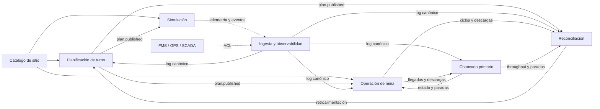

# Digital Mine — Análisis de dominio DDD-lite

| Versión | Fecha | Estado | Base |
|---|---|---|---|
| 0.1 | 22 de octubre de 2026 | Borrador para revisión | Documentos 01 a 06 y 08 |

> Este documento aplica **DDD-lite** al MVP de Digital Mine. No es un documento de requisitos, no describe una implementación y no reemplaza el [alcance](01-alcance-mvp.md), la [arquitectura](02-arquitectura.md), el [backlog](03-backlog.md), el [SRS](04-srs.md), el [VSM](06-vsm.md) ni las [ADR](08-adr.md). El estado del proyecto está en [05 — Progreso y decisiones](05-decisiones.md). No existe todavía una aplicación ejecutable ni datos generados.

## 1. Propósito, alcance y método

**DDD-lite** es el subconjunto de *Domain-Driven Design* que este proyecto usa para acordar lenguaje, límites e invariantes, sin adoptar el aparato táctico completo. Se aplica sobre un monolito modular event-driven (ADR-001, propuesto) y un MVP documental.

Incluye lenguaje ubicuo, contextos delimitados, agregados e invariantes, eventos de dominio, mapa de contextos y servicios o políticas. Queda fuera:

| Excluido | Motivo |
|---|---|
| Event Storming formal | El método acordado es ADR + C4 + SRS y lo excluye (DL-004, [05](05-decisiones.md) §2). |
| Arquitectura hexagonal o puertos y adaptadores | [02](02-arquitectura.md) §1 ya fija monolito modular y adaptadores reemplazables; DDD-lite no agrega capas. |
| Repositorios y fábricas | La persistencia vive en `packages/db`; los agregados se crean desde la API o desde eventos. |
| Event sourcing completo | Solo los hechos operacionales son log; plan y configuración son maestros versionados, y ciclos, KPIs y alertas son proyecciones (ADR-010, propuesto). |
| CQRS formal | Hay proyecciones de lectura, pero no dos stores ni bus de comandos. |
| Un microservicio por contexto | Los contextos son límites lógicos; el MVP sigue siendo un monolito modular. |

El análisis siguió cinco pasos: leer etapas y puntos de captura del VSM; agrupar por lenguaje y ciclo de vida; contrastar con los módulos de la arquitectura; modelar agregados solo donde las fuentes definen invariantes; y mapear cada evento a un requisito.

Convención: **Confirmado** es un hecho del alcance o requisito del SRS; **Propuesto**, un modelo o evento de este documento o de la arquitectura; **Supuesto**, un juicio analítico; **TBD**, una regla, fórmula o contrato no definido, que remite a ADR-014 o al SRS v0.2. El texto no marcado es análisis propuesto. DDD-lite **no crea requisitos**: si hay conflicto, el SRS gobierna la verificación y la ADR el diseño.

## 2. Lenguaje ubicuo

La documentación y la UI usan español; los nombres de eventos, tablas y tipos se mantienen en inglés para no romper los contratos de [02](02-arquitectura.md) §5 y §6.

| Término | Definición en este proyecto | Alineación | Estado |
|---|---|---|---|
| Plan de turno | Metas por frente y destino, y asignación de flota, en versiones inmutables. | FR-PLAN-01/02; ADR-012 | Confirmado; versionado propuesto |
| Plan base | Versión vigente al inicio del turno; línea base oficial de la reconciliación. | ADR-012 | Propuesto |
| Meta | Tonelaje objetivo de un frente hacia un destino en una versión de plan. | FR-PLAN-01; ADR-014.1 | Confirmado; unidad TBD |
| Asignación | Vínculo camión–pala dentro de una versión de plan; no es una orden de despacho. | [02](02-arquitectura.md) §6; ADR-012.6 | Confirmado; versionado propuesto |
| Turno | Ventana de 8 h con plan, ejecución y cierre; unidad de planificación y reconciliación. | [01](01-alcance-mvp.md) §6; ADR-011 | Confirmado; ciclo de vida propuesto |
| Corrida | Ejecución del simulador con semilla, escenario, aceleración y reloj propios. Un turno puede tener varias. | ADR-011 | Propuesto |
| Frente | Zona de carguío de un banco, con geometría y material declarado (`dig_units`). | [01](01-alcance-mvp.md) §8; [02](02-arquitectura.md) §6 | Confirmado |
| Banco | Nivel horizontal de excavación del tajo (`benches`). | [01](01-alcance-mvp.md) §8 | Confirmado |
| Ore | Material que se envía al chancador. El alcance sitúa la clasificación en la descarga; ADR-013 propone el carguío. | [01](01-alcance-mvp.md) §2 y §6; ADR-013 | Abierto (P0-06) |
| Waste | Material estéril que va al botadero. | [01](01-alcance-mvp.md) §6 | Confirmado |
| ROM | Mineral bruto que alimenta al chancador; no se modela stockpile ROM. | [01](01-alcance-mvp.md) §6 y §8 | Confirmado como concepto; no es entidad |
| Ciclo | Secuencia carguío → acarreo → descarga → retorno de un camión. | [01](01-alcance-mvp.md) §8; [06](06-vsm.md) §2 | Confirmado; ventana TBD |
| Carguío | Operación de la pala que carga un camión en un frente. | [01](01-alcance-mvp.md) §2 | Confirmado |
| Acarreo | Transporte del camión cargado por una ruta hasta el destino. | [01](01-alcance-mvp.md) §2 | Confirmado |
| Descarga | Transferencia en chancador o botadero; registra destino y tonelaje. | [01](01-alcance-mvp.md) §2 | Confirmado |
| Chancado primario | Primera reducción de tamaño; límite del MVP. | [01](01-alcance-mvp.md) §8 | Confirmado |
| Chancador | Equipo del chancado primario; estado, tolva, alimentación, throughput y paradas. | [02](02-arquitectura.md) §5.4 y §6 | Confirmado como activo; modelo propuesto |
| Throughput | Toneladas por hora procesadas; distinto de la alimentación. | [01](01-alcance-mvp.md) §8 | Confirmado; fórmula TBD |
| Reconciliación | Comparación plan vs ejecución por turno, frente y destino; la línea base propuesta es el plan base (ADR-012). | [01](01-alcance-mvp.md) §8; FR-REC-01 | Confirmado; línea base y fórmula TBD |
| Cumplimiento | Resultado de comparar real y meta; fórmula y ponderación TBD. | FR-REC-01; ADR-014.1 | Confirmado como concepto; TBD |
| Telemetría | Medición periódica (1 Hz en el MVP); no es evento de dominio. | [02](02-arquitectura.md) §5; ADR-010 | Confirmado |
| Evento | Hecho inmutable con tipo, identidad, tiempo y payload. | [02](02-arquitectura.md) §5.1; ADR-009 | Confirmado; contrato propuesto |
| Evento derivado | Cálculo del servidor (KPI, alerta, salud) que no vuelve al bus. | ADR-010 | Propuesto |
| Alerta | Instancia de una regla cumplida, con estado e historia. | FR-ALR-01; ADR-014.2 | Confirmado; reglas TBD |
| Fuente | Sistema o adaptador que produce datos: simulador, FMS, GPS, SCADA o báscula. | [01](01-alcance-mvp.md) §5.2; [04](04-srs.md) §5.6 | Confirmado |
| FuenteDeDatos | Registro de salud y frescura de una fuente. | [02](02-arquitectura.md) §6; ADR-010 | Propuesto |
| Cola | Camiones esperando en una pala o en la descarga; es proyección, no agregado. | [06](06-vsm.md) §5; FR-FLT-01 | Propuesto |

Términos que se evitan para no crear sinónimos contradictorios:

| Se evita | Se usa | Motivo |
|---|---|---|
| “Mineral” sin calificar | `ore`, `waste` o ROM | No distingue destino ni clasificación. |
| “Estéril” en código o eventos | `waste` | El valor canónico es `waste`. |
| “Viaje” | Ciclo | Un viaje no incluye carguío y retorno. |
| “Despacho” para la asignación del MVP | Asignación | El MVP no despacha ni optimiza; el despacho es del FMS. |
| “Acopio” o “stockpile” | Muck pile o tolva | No se modela stockpile ROM ([01](01-alcance-mvp.md) §6). |
| “Lote” | Turno | El turno es el lote de planificación del VSM. |
| “Evento” para telemetría | Telemetría | La telemetría es una medición; el evento es un hecho. |
| “Alerta” para la regla | Regla de alerta | La alerta es la instancia; la regla es la condición. |
| “Plan” para una versión | `planId` y `planVersion` | Un plan tiene versiones inmutables (ADR-012). |
| “Turno” para una ejecución del simulador | Corrida | El turno es la ventana; la corrida es la ejecución (ADR-011). |

## 3. Contextos delimitados

Se proponen **siete contextos**: cuatro de negocio y tres de soporte. Son límites de modelo y de propiedad de datos, no unidades de despliegue. Todos, salvo Simulación, viven en el monolito modular; el Catálogo se implementa como datos maestros y API.

**Planificación de turno (negocio).** Convierte el estado de frentes, flota y cierre anterior en un plan versionado. *Responsabilidades:* metas, asignación, validación, publicación y vigencia. *Datos:* `Plan`, `Meta`, `Asignación` y `Turno` (cuyo ciclo de vida aplica el servidor, ADR-011). *Publica* `plan.published`; *consume* `reconciliation.completed`, `shift.*` y catálogo. *Límites:* no ejecuta, no mide, no calcula KPIs; un ajuste es una versión nueva.

**Operación de mina (negocio).** Refleja la ejecución física desde la perforación hasta la descarga. *Responsabilidades:* estado de equipos y frentes, ciclos, colas, perforación, voladura, carguío, acarreo y descarga; asigna destino según material. *Datos:* `EquipoOperativo` (estado), `DisponibilidadFrente`, `Ciclo` y `Cola` (proyecciones); hechos de operación. *Publica* `equipment.status_changed`, `drill.*`, `blast.detonated`, `truck.*`; *consume* `plan.published`, telemetría y `crusher.*`. *Límites:* no calcula KPIs oficiales ni reconcilia; no controla equipos reales; no optimiza el despacho; no posee el chancador. Perforación y voladura son un subárea *event-only* (D-03); si crece, se evalúa separar “Preparación de mina” (§10).

**Chancado primario (negocio).** Refleja estado y desempeño del chancador y su tolva. *Responsabilidades:* estados `running`, `stopped`, `blocked` y `maintenance`; alimentación, throughput y tolva; paradas y disponibilidad. *Datos:* `Chancador`, `Parada` y `crusher_samples`. *Publica* `crusher.telemetry`, `crusher.downtime_*`, `crusher.blocked_*`; *consume* `truck.arrived_at_destination`, `truck.dumped` (ore) y catálogo. *Límites:* no decide a qué camión atender; no programa mantenimiento; no modela planta downstream; no posee la cola, que es de Operación.

**Reconciliación (negocio).** Compara plan base y ejecución, y cierra el turno. *Responsabilidades:* seleccionar el plan base; agregar tonelaje por turno, frente, destino y material; calcular cumplimiento; congelar el snapshot; emitir el cierre. *Datos:* `SnapshotKPI` oficial, `ReporteCumplimiento` y referencias a plan y turno. *Publica* `kpi.snapshot` (derivado) y `reconciliation.completed`; *consume* `plan.published`, `shift.ended`, `truck.dumped`, ciclos y `crusher.downtime_*`. *Límites:* solo lee hechos; no corrige eventos ni reescribe el plan; no calcula KPIs en vivo; no define fórmulas (ADR-012 y ADR-014).

**Ingesta y observabilidad (soporte).** Recibe, valida, deduplica, ordena y persiste; mide salud y pipeline y evalúa alertas. *Responsabilidades:* MQTT, Zod, deduplicación por `eventId`, orden canónico, log, telemetría, salud, métricas y catálogo de reglas; el motor se implementa en el módulo Gemelo ([02](02-arquitectura.md) §3.1). *Datos:* `Evento`, `Telemetría`, `FuenteDeDatos`, `Alerta` y métricas. *No publica eventos de negocio en el bus*; salud y alertas se entregan por API y WebSocket (ADR-010); *consume* todos los mensajes y `source.heartbeat`. *Límites:* no calcula ciclos ni KPIs; no reescribe `occurredAt` (ADR-008).

**Simulación (soporte).** Genera un turno sintético reproducible que se comporta como fuente real. *Responsabilidades:* reloj, semilla, escenario, configuración, telemetría, eventos e hitos del turno. *Datos:* `Corrida`, configuración, semilla, escenario y reloj; usa el layout del catálogo. *Publica* `sim.run_started`, `shift.started`, `shift.ended`, telemetría y eventos con `simulated=true`; *consume* `plan.published` y catálogo. *Límites:* no calcula KPIs ni reconcilia; no posee el gemelo; es reemplazable por fuentes reales (ADR-004); su modelo cruza una ACL.

**Catálogo de sitio (soporte).** Mantiene la definición estable del sitio y sus activos. *Responsabilidades:* sitio, bancos, frentes (geometría y material), rutas, destinos, equipos y operadores de referencia. *Datos:* tablas maestras de [02](02-arquitectura.md) §6. *Expone* cambios por API; la auditoría de cambios es TBD (ADR-010); *consume* migraciones y seed. *Límites:* no posee estado operativo, ciclos, KPIs ni salud; no es un servicio aparte.

**Justificación.** Los cuatro contextos de negocio tienen lenguajes, cadencias y dueños distintos: el plan se mueve por turno, la operación por segundos, el chancado por estado y la reconciliación por cierre. Los tres de soporte tienen modelos técnicos propios: el log y la salud, el reloj y la semilla, y el catálogo. Separarlos evita que el estado operativo dependa del plan y que la reconciliación dependa del simulador.

## 4. Mapa de contextos

La flecha va de **upstream** a **downstream**; las líneas punteadas indican una relación mediada por una capa anticorrupción (ACL). No es un diagrama C4: el modelo C4 previsto está en `09-c4.md`.



*Figura 1. Mapa de contextos. El bucle Planificación → Operación → Reconciliación → Planificación es intencional: cierra el ciclo del VSM y no comparte estado mutable.*

| Upstream → downstream | Patrón | Qué cruza | Riesgo | Decisión |
|---|---|---|---|---|
| Catálogo → Planificación | Customer/Supplier | Identidades, geometría y capacidad | Un cambio maestro invalida un plan | API maestra versionada (ADR-010) |
| Catálogo → Operación y Simulación | Conformist | Identidades, layout y flota | Acoplamiento al seed | ADR-014.3 |
| Planificación → Operación y Simulación | Customer/Supplier + lenguaje publicado | `plan.published` versionado | Ajustes a mitad de turno | ADR-012 |
| Simulación → Ingesta | ACL | Eventos y telemetría canónicos | El modelo del simulador se filtra | ADR-004 y ADR-009 |
| Ingesta → Planificación, Operación, Chancado y Reconciliación | Lenguaje publicado (soporte) | Log deduplicado y ordenado | Acoplamiento al log | ADR-009 y ADR-010 |
| Operación → Chancado | Customer/Supplier | Llegadas y descargas de ore | Cola no instrumentada | `truck.arrived_at_destination` |
| Chancado → Operación | Customer/Supplier | Estado, paradas y throughput | La cola aguas arriba no reacciona | ADR-014.1 y ADR-014.2 |
| Operación → Reconciliación | Customer/Supplier | Ciclos y descargas | Doble conteo | ADR-010 |
| Chancado → Reconciliación | Customer/Supplier | Throughput y paradas | Disponibilidad TBD | FR-CRU-02 |
| Planificación → Reconciliación | Customer/Supplier | Plan base y versiones | Baseline ambigua | ADR-012 |
| Reconciliación → Planificación | Customer/Supplier | Cierre y retroalimentación | El bucle se confunde con un comando | FR-REC-02 |
| FMS/GPS/SCADA → Ingesta; `PlanSource` → Planificación | ACL | Eventos canónicos y plan externo | Conformismo con el proveedor | ADR-004; D-14; P1-01 |

**Shared kernel.** No se propone. `packages/domain` contiene tipos transversales (identidades, tiempo, unidades y envelope), pero no un modelo co-poseído por dos contextos. Cada contexto define su modelo y comparte solo el contrato de eventos; el envelope es **lenguaje publicado**, no shared kernel.

**ACL.** Se ubica en los adaptadores de ingesta y en la frontera del simulador. Traduce el modelo de la fuente —FMS, GPS, SCADA o el simulador— al lenguaje canónico, valida con Zod y no importa tipos del dominio. El simulador implementa el contrato canónico, pero su reloj, semilla y configuración no se comparten; tratarlo como ACL permite reemplazarlo por un FMS sin cambiar el dominio.

## 5. Agregados, entidades y objetos de valor

Un agregado es una frontera de consistencia. Solo se declaran invariantes que las fuentes permiten sostener; las reglas operativas no definidas quedan TBD. Las referencias entre agregados son por identidad, nunca por objeto.

| Agregado raíz o entidad | Entidades y VOs | Invariantes | Eventos | Tipo |
|---|---|---|---|---|
| `Turno` | `ShiftId`, `VentanaTurno`, `EstadoTurno` | Un turno activo por sitio (ADR-011); `scheduled → active → closing → closed`; no se cierra sin reconciliación; 8 h. | Consume `shift.*` y `reconciliation.completed`; no publica evento propio (TBD). | Transaccional |
| `Plan` | `PlanId`, `PlanVersion`, `EffectiveFrom`, `Supersedes`; `Meta`, `Asignación` | Versiones inmutables; una vigente por instante; metas no negativas; un material por frente y versión (ADR-012 y ADR-013). | `plan.published` | Transaccional versionado |
| `Meta` | `Tonnage`, `MaterialType` | Clave versión/frente/destino; valor no negativo; unidad explícita. Prorrateo TBD. | Vía `plan.published` | Parte de `Plan` |
| `Asignación` | ids de camión y pala | Pertenece a la versión y no se muta; una asignación vigente por camión (supuesto); compatibilidad TBD; reasignación manual post-MVP (D-09). | Vía `plan.published` | Parte de `Plan` |
| `Equipo` | `EquipmentId`, `TipoEquipo`, `CapacidadNominal` | Identidad única; tipo válido; capacidad mayor que cero; pertenece a un sitio. | Cambios por API; auditoría TBD (ADR-010). | Catálogo |
| `EquipoOperativo` | `EstadoEquipo` | Transiciones de [02](02-arquitectura.md) §5.4; `down` desde cualquier estado; transición válida. | `equipment.status_changed`; consume telemetría. | Transaccional (caché del log) |
| `Frente` | `DigUnitId`, `BancoId`, `Poligono`, `MaterialType` | Pertenece a un banco; geometría válida (TBD, D-04); material `ore` o `waste` por versión (ADR-013). | Cambios por API. | Catálogo |
| `DisponibilidadFrente` | `DigUnitId`, `EstadoFrente` | Derivada de patrón y tronadura; no se libera sin ambos (supuesto, D-03); no modela muck pile. | Consume `drill.pattern_completed` y `blast.detonated`. | Proyección |
| `Ruta` | `RouteId`, `Origen`, `Destino`, `Segmentos` | Conecta un frente con un destino; sentido y longitud consistentes; geometría TBD (D-04). | Cambios por API. | Catálogo |
| `Destino` | `DestinationId`, `TipoDestino`, `Capacidad` | Chancador o botadero; ore→chancador y waste→botadero (ADR-013); capacidad del botadero TBD. | Cambios por API. | Catálogo |
| `Ciclo` | `CycleId`, `FaseCiclo`, `Tonnage` | Un ciclo abierto por camión y corrida (supuesto); fases en orden; la ventana de cierre es TBD (ADR-014.1); clave idempotente (ADR-009). | Consume `truck.*`; no publica. | Proyección |
| `Chancador` | `EquipmentId`, `EstadoChancador`, `NivelTolva` | Estados de [02](02-arquitectura.md) §5.4; una parada abierta a la vez (supuesto); `blocked` no es `stopped`; si cuenta como parada es TBD (ADR-014.1). | `crusher.downtime_*`, `crusher.blocked_*`; consume telemetría. | Transaccional |
| `Alerta` | `AlertId`, `RuleId`, `RuleVersion`, `ScopeKey` | Una activa por `(ruleId, scopeKey)` (ADR-014.2); historia inmutable; `raised → cleared`. | `alert.raised`, `alert.cleared` (derivados). | Derivado |
| `SnapshotKPI` | `SnapshotId`, `Scope`, `Period`, `FormulaVersion` | Inmutable al cierre (ADR-010); una versión de fórmula; agregado por turno, frente y destino (FR-REC-01). | `kpi.snapshot` | Derivado |
| `FuenteDeDatos` | `SourceId`, `TipoFuente`, `UltimaSenal` | Salud por tiempo real; una fuente pausada no es caída (ADR-008); frescura TBD (ADR-014.1). | Consume `source.heartbeat`; salud por API y WebSocket. | Derivado |
| `Corrida` | `RunId`, `Semilla`, `Escenario`, `Aceleracion` | Una activa por turno (ADR-011); parámetros inmutables; `shiftId` obligatorio. | `sim.run_started` | Transaccional (soporte) |

| Value object | Representa | Regla |
|---|---|---|
| `SiteId`, `ShiftId`, `PlanId`, `EquipmentId`, `DigUnitId`, `DestinationId`, `RouteId`, `RunId`, `EventId`, `SourceId` | Identidades | UUID; no se reutilizan. `PlanVersion` es entero y crece desde 1. |
| `OccurredAt`, `SentAt`, `ReceivedAt`, `TimeDomain` | Tiempo | Dominios separados; `occurredAt` inmutable (ADR-008). |
| `MaterialType` | Material | `ore` o `waste`; sin leyes ni mezcla. |
| `Tonnage` | Tonelaje | Unidad métrica; la unidad oficial de KPI está TBD (ADR-014.1). |
| `FaseCiclo`, `EstadoEquipo`, `EstadoChancador` | Estados | Valores de [02](02-arquitectura.md) §5.4. |
| `VentanaTurno` | Inicio y fin | 8 h; UTC para almacenar y zona del navegador para mostrar. |
| `RuleVersion`, `FormulaVersion` | Versión de catálogo | Un cambio de regla o fórmula crea una versión nueva (ADR-014). |

**Catálogo, transaccional, proyección y derivado.** Son **catálogo o maestro** Sitio, Banco, Frente (ficha), Ruta, Destino y Equipo (ficha); su autoridad es la configuración versionada (ADR-010). Son **transaccionales** Turno, Plan (versiones inmutables), EquipoOperativo, Chancador y Corrida; los estados operativos son caché del log. Son **proyecciones** Ciclo, Cola y DisponibilidadFrente. Son **derivados** KPI, Alerta y FuenteDeDatos.

`Meta` y `Asignación` no son raíces: viven dentro de la versión de `Plan`. `Ciclo` tiene identidad e invariantes, pero es una proyección: no es fuente de verdad y no publica eventos. `Cola` tampoco es un agregado: es una vista sobre `truck.queued`, `truck.loading_started`, `truck.arrived_at_destination` y `truck.dumped`.

## 6. Eventos de dominio

La lista de [02](02-arquitectura.md) §5.3 se amplía con consumidores, disparador, payload mínimo y requisito. No se repiten los tópicos MQTT ni el envelope. La telemetría se incluye porque la arquitectura la trata como mensaje, pero su naturaleza es **medición**, no evento de dominio. En el MVP, el simulador es el productor físico de casi todos los eventos; la columna indica el contexto lógico al que pertenece el hecho, y las fuentes reales lo producirán en su lugar.

| Evento | Naturaleza | Contexto productor → consumidores | Disparador | Payload mínimo propuesto | FR | Estado |
|---|---|---|---|---|---|---|
| `plan.published` | Evento | Planificación → Operación, Simulación, Reconciliación, UI | Publicación de una versión válida | `{planId, planVersion, shiftId, effectiveFrom, supersedes, metas[], asignaciones[]}` | FR-PLAN-02 | Confirmado (FR-PLAN-02); payload propuesto |
| `sim.run_started` | Evento | Simulación → Ingesta, Reconciliación, UI | Arranque de la corrida | `{runId, shiftId, seed, scenario, acceleration, configVersion, planVersion, clockEpoch}` | FR-SIM-02; NFR-DET-01 | Propuesto nuevo (ADR-011) |
| `shift.started` | Evento | Simulación → Planificación, Operación, Reconciliación | Inicio del turno simulado | `{shiftId, runId, occurredAt}` | FR-SIM-01; FR-REC-02 | Propuesto (02); productor ADR-011 |
| `shift.ended` | Evento | Simulación → Planificación, Reconciliación | Fin del turno simulado | `{shiftId, runId, occurredAt}` | FR-REC-02 | Propuesto (02); productor ADR-011 |
| `equipment.telemetry` | Telemetría | Fuente o simulador → Ingesta, Operación, UI | Tick de 1 Hz | `{equipmentId, position, speed, state, load}` | FR-SIM-04; FR-MAP-01 | Propuesto (02) |
| `equipment.status_changed` | Evento | Operación → Ingesta, proyecciones, UI | Transición válida de la máquina | `{equipmentId, from, to, reason}` | FR-TWIN-01 | Propuesto (02) |
| `drill.pattern_started` | Evento | Operación → UI | Inicio de un patrón | `{drillId, digUnitId, patternId, startedAt}` | FR-DRILL-01 | Propuesto nuevo |
| `drill.pattern_completed` | Evento | Operación → Operación, Reconciliación, UI | Fin de un patrón | `{drillId, digUnitId, patternId, meters, endedAt}` | FR-DRILL-01 | Propuesto (02) |
| `blast.detonated` | Evento | Operación → Operación, Reconciliación, UI | Detonación | `{blastId, digUnitId, estimatedTonnes, materialType, detonatedAt}` | FR-DRILL-01 | Propuesto (02) |
| `truck.queued` | Evento | Operación → Ciclos, UI | El camión entra a una cola | `{truckId, queueId, resourceId, queuedAt}` | FR-FLT-01 | Propuesto (02); payload ampliado |
| `truck.loading_started` | Evento | Operación → Ciclos, UI | La pala inicia la carga | `{truckId, shovelId, digUnitId, materialType, plannedDestinationId}` | FR-TWIN-03 | Propuesto (02) |
| `truck.loaded` | Evento | Operación → Ciclos, Reconciliación | Termina la carga | `{truckId, shovelId, digUnitId, materialType, tonnes, plannedDestinationId}` | FR-TWIN-03; FR-REC-01 | Propuesto (02); payload ADR-013 |
| `truck.hauling_started` | Evento | Operación → Ciclos, UI | El camión sale del frente | `{truckId, routeId, destinationId, startedAt}` | FR-TWIN-03; FR-MAP-01 | Propuesto (02) |
| `truck.arrived_at_destination` | Evento | Operación → Chancado, Ciclos, UI | El camión llega al destino | `{truckId, destinationId, queueId, arrivedAt}` | FR-FLT-01 | Propuesto nuevo; cierra Q-03 |
| `truck.dumped` | Evento | Operación → Ciclos, Chancado, Reconciliación | Termina la descarga | `{truckId, destinationId, materialType, tonnes, dumpedAt}` | FR-TWIN-03; FR-REC-01 | Propuesto (02); payload ADR-013 |
| `truck.returning` | Evento | Operación → Ciclos, UI | Inicia el retorno | `{truckId, routeId, startedAt}` | FR-TWIN-03 | Propuesto (02) |
| `crusher.telemetry` | Telemetría | Chancado → Ingesta, UI, Alertas | Tick de 1 Hz | `{crusherId, feedRate, throughput, binLevel, state}` | FR-CRU-01 | Propuesto (02) |
| `crusher.downtime_started` | Evento | Chancado → Operación, Reconciliación, Alertas | Entrada en `stopped` | `{crusherId, reason, startedAt}` | FR-CRU-02 | Confirmado (FR-CRU-02) |
| `crusher.downtime_ended` | Evento | Chancado → Operación, Reconciliación, Alertas | Vuelta a `running` | `{crusherId, endedAt}` | FR-CRU-02 | Confirmado (FR-CRU-02) |
| `crusher.blocked_started` | Evento | Chancado → Operación, Reconciliación, Alertas | Entrada en `blocked` | `{crusherId, reason, startedAt}` | FR-CRU-01; FR-CRU-02 | Propuesto nuevo; nombre TBD |
| `crusher.blocked_ended` | Evento | Chancado → Operación, Reconciliación, Alertas | Salida de `blocked` | `{crusherId, endedAt}` | FR-CRU-01; FR-CRU-02 | Propuesto nuevo; nombre TBD |
| `kpi.snapshot` | Derivado | Reconciliación o gemelo → UI | Snapshot periódico o cierre | `{kpiId, scope, period, value, unit, formulaVersion}` | FR-TWIN-03; FR-REC-01 | Derivado (ADR-010) |
| `reconciliation.completed` | Evento | Reconciliación → Planificación, UI | Cierre del turno | `{shiftId, planId, planVersion, kpiSnapshotId, closedAt}` | FR-REC-01; FR-REC-02 | Propuesto nuevo |
| `source.heartbeat` | Evento | Fuente → Ingesta | Latido periódico | `{sourceId, sentAt}` | FR-DF-02 | Propuesto nuevo (ADR-010) |
| `data_source.health` | Derivado | Ingesta → UI | Cálculo periódico de salud | `{sourceId, state, lastSeenAt, lag, errors}` | FR-DF-02 | Derivado (ADR-010) |
| `alert.raised` | Derivado | Ingesta y observabilidad → UI | Se cumple una condición | `{alertId, ruleId, ruleVersion, scopeKey, severity, context}` | FR-ALR-01 | Derivado (ADR-010); 02 lo lista como evento |
| `alert.cleared` | Derivado | Ingesta y observabilidad → UI | Deja de cumplirse la condición | `{alertId, clearedAt, cause}` | FR-ALR-01 | Derivado (ADR-010); 02 lo lista como evento |

**Eventos nuevos.** `truck.arrived_at_destination` cierra la brecha de la cola en chancador ([06](06-vsm.md) §5 y §9, Q-03, P0-02); la alternativa es derivarla de telemetría, y la decisión es de ADR-009. `crusher.blocked_started/ended` convierte el estado `blocked` en evento; el estado existe en [02](02-arquitectura.md) §5.4 pero no estaba listado, y si cuenta como parada es TBD (ADR-014.1 y ADR-014.2). `drill.pattern_started` permite medir la duración del patrón. `reconciliation.completed` da un disparador explícito al cierre y a la retroalimentación (FR-REC-02, ADR-011). `sim.run_started` es la evidencia de reproducibilidad (ADR-011, NFR-DET-01). `source.heartbeat` permite reportar latido sin convertir la salud en evento de negocio (ADR-010).

También se amplía `truck.queued` con `queueId` y `resourceId`, para distinguir cola de pala y de descarga. No se propone `cycle.completed` porque el ciclo es proyección (ADR-010); ni `plan.changed`, porque `plan.published` lleva `planVersion` y `supersedes` (ADR-012); ni `shift.closed`, porque el cierre se expresa con `reconciliation.completed` y el estado del turno.

**Contrato.** Los nombres siguen el pasado y el dominio en inglés, como en [02](02-arquitectura.md) §5.3. El `eventVersion` arranca en 1; el envelope v2 propuesto agrega `runId` y `seq` (ADR-009). Los payloads de la tabla son mínimos propuestos: el contrato por tipo es TBD (P1-01, SRS §5.4). Los derivados no se publican en el MQTT operacional; si se publican, usan tópicos separados y `derived=true` (ADR-010). La telemetría se deduplica por `(runId, streamId, seq)` (ADR-009).

## 7. Servicios y políticas de dominio

| Servicio o política | Contexto | Entrada → salida | Regla vigente | Estado |
|---|---|---|---|---|
| Asignación camión–pala | Planificación y Operación | Plan, flota, frentes y colas → asignación vigente | Viene del plan; el escenario `truck_failure` redistribuye la flota restante con una regla TBD (ADR-014.3); no hay despacho automático ni optimización. | Redistribución TBD; reasignación manual post-MVP (D-09) |
| Proyección de ciclos | Operación | `truck.*` → `Ciclo` | Orden canónico (ADR-009); un ciclo abierto por camión (supuesto); clave idempotente; la telemetría no cuenta tonelaje (ADR-010). | Ventana y ciclos abiertos al cierre TBD |
| Cálculo de KPIs | Reconciliación y gemelo | Ciclos, eventos, plan, telemetría y salud → `kpi.snapshot` | Catálogo versionado (ADR-014.1); el snapshot en vivo es provisional y el oficial se congela al cierre (ADR-010). | Fórmulas, grano y redondeo TBD |
| Reconciliación | Reconciliación | Plan base, descargas, ciclos y chancado → cumplimiento y reporte | Plan base (ADR-012); material del carguío y destino real (ADR-013); sin doble conteo. | Ponderación y prorrateo TBD (ADR-014.1) |
| Evaluación de alertas | Ingesta y observabilidad | Estado, eventos y salud → `alert.raised` y `alert.cleared` | Catálogo con dominio temporal, histéresis y una alerta por `(ruleId, scopeKey)` (ADR-014.2); en pausa y replay no se crean alertas. | Umbrales y definiciones TBD |
| Generación de escenarios | Simulación | Configuración, escenario y semilla → corrida determinista | Superposición determinista elegida al inicio (ADR-014.3); PRNG sembrado; sin reloj de pared. | Parámetros TBD |
| Liberación de frente | Operación | `drill.pattern_completed`, `blast.detonated` → frente disponible | El alcance dice que la voladura libera el frente; si se exige el patrón completo es TBD (D-03). No modela muck pile. | Regla exacta TBD |
| Cierre de turno | Reconciliación y Planificación | `shift.ended`, ventana de gracia y plan base → KPIs oficiales y `reconciliation.completed` | ADR-011: `closing`, espera de tardíos, reconciliación y congelamiento. | Ventana de gracia y ciclos abiertos TBD |

**TBD en ADR-014.** ADR-014.1 debe cerrar tonelaje (cargado o descargado, báscula o evento), ventana del ciclo, tiempo de cola, denominador de utilización, throughput instantáneo o promedio, ponderación y prorrateo del cumplimiento, frescura, redondeo y versionado de fórmulas. ADR-014.2, umbrales, “camión inactivo”, `blocked` y `maintenance`, alcance de la cola, histéresis, severidad y comportamiento en pausa o replay. ADR-014.3, capacidades, velocidades, tiempos, disciplina de colas, tolva, fallas, escenarios y `tick`. También quedan TBD la validación de asignaciones (ADR-012), los ciclos abiertos y la ventana de gracia (ADR-011), el punto de clasificación y el tonelaje oficial (ADR-013), el evento de cola y los tardíos (ADR-009), el dominio temporal de retención (ADR-008), el detalle de perforación y voladura (D-03) y la reasignación manual (D-09).

## 8. Relación con la arquitectura

### 8.1 `packages/domain`

[02](02-arquitectura.md) §3 asigna al paquete entidades, tipos de evento, máquinas de estado, fórmulas y validaciones. DDD-lite se refleja así, como propuesta de organización y no como decisión de despliegue:

```text
packages/domain/
  shared/          identidades, tiempo, unidades, envelope, errores
  catalog/         sitio, banco, frente, ruta, destino, equipo
  planning/        turno, plan, meta, asignación, publicación
  operations/      estado de equipo, disponibilidad, ciclo, cola
  crushing/        chancador, parada, throughput
  reconciliation/  plan base vs real, KPI, cierre
  events/          esquemas Zod y tipos por eventType
```

Cada carpeta puede contener el modelo de un contexto, pero **contexto no es paquete**: un contexto puede ocupar varias carpetas y una carpeta puede servir a varios. `shared` contiene tipos transversales, no un modelo de negocio compartido. El dominio no importa Drizzle, Fastify, MQTT ni React; exporta tipos, funciones puras, esquemas Zod, máquinas de estado y catálogos. La ingesta y la API dependen del dominio, no al revés. Las proyecciones se reconstruyen desde el log (ADR-010) y se prueban con el mismo orden canónico. Esto cumple la dirección de dependencias sin arquitectura hexagonal.

### 8.2 Envelope

El envelope de [02](02-arquitectura.md) §5.1 es el lenguaje publicado del mapa. DDD-lite no agrega campos propios: `runId`, `seq`, `streamId` y `derived` vienen de ADR-008 a ADR-010. La tabla solo aclara qué representa cada campo.

| Concepto DDD | Campo | Nota |
|---|---|---|
| Tipo de evento | `eventType` | Nombre del evento; el payload se define en §6. |
| Identidad del hecho | `eventId` | UUID del productor; clave de idempotencia (ADR-009). |
| Agregado de origen | Identificador en `payload` | `shiftId`, `planId`, `truckId`, `crusherId`, etc. |
| Contexto productor | `source` | `simulator`, `fms`, `scada`. |
| Correlación y tiempo | `correlationId`, `occurredAt`, `sentAt` | Tiempo del hecho inmutable; `sentAt` mide latencia (ADR-008). |
| Origen sintético y orden | `simulated`, `runId`, `seq`, `streamId` | `simulated` distingue dato sintético; orden v2 (ADR-009). |
| Derivado | `derived` | Propuesto para lo que no es hecho operacional (ADR-010). |

### 8.3 Máquinas de estado

| Máquina | Contexto | Agregado | Eventos | Nota |
|---|---|---|---|---|
| Camión | Operación | `EquipoOperativo`, `Ciclo` | `truck.*`, `equipment.status_changed` | `idle → queued → loading → hauling → dumping → returning → idle`; `down` desde cualquier estado. |
| Pala | Operación | `EquipoOperativo` | `equipment.status_changed`, `truck.loading_started` | `idle → loading → waiting → idle`; `down`. |
| Perforadora | Operación | `EquipoOperativo` | `equipment.status_changed`, `drill.pattern_*` | `idle → moving → drilling → idle`; `down`. |
| Chancador | Chancado | `Chancador` | `crusher.*` | `running → stopped` y `running → blocked`; `maintenance`. |

Las transiciones viven en [02](02-arquitectura.md) §5.4 y se prueban de forma unitaria. Este documento no las duplica: asigna cada máquina a un contexto y a un agregado. El productor emite el evento; el dominio valida que la transición sea posible.

### 8.4 Tablas

| Agregado u objeto | Tabla(s) | Naturaleza | Nota |
|---|---|---|---|
| `Turno` | `shifts` | Transaccional | Estado y ventana. |
| `Plan`, `Meta`, `Asignación` | `plans`, `plan_targets`, `assignments` | Transaccional versionado | Versiones inmutables (ADR-012). |
| `Equipo` y `Chancador` | `equipment`, `crusher_samples`, `events` | Catálogo y transaccional | Ficha, series y paradas. |
| `Frente` | `dig_units`, `benches` | Catálogo | Geometría y material. |
| `Ruta` y `Destino` | `roads`, `destinations` | Catálogo | Grafo y tipos de destino. |
| `Ciclo` | `cycles` | Proyección | Derivada de eventos (ADR-010). |
| `Alerta` | `alerts` | Derivado con historia | Reglas simples (ADR-014.2). |
| `FuenteDeDatos` | `data_sources`, `data_flow_metrics` | Derivado | Salud y métricas. |
| `Corrida` | `simulation_runs` | Transaccional de soporte | **Nueva**: ADR-011 la propone y [02](02-arquitectura.md) §6 no la lista. |
| Log, telemetría y KPI | `events`, `telemetry`, `kpi_snapshots` | Hechos y derivado | Autoridad de hechos y snapshot oficial. |

No se proponen tablas por contexto: los contextos no son esquemas. Una tabla puede servir a varios y un contexto puede leer varias. La única tabla nueva detectada es `simulation_runs`, que debe incorporarse a [02](02-arquitectura.md) §6 si ADR-011 se acepta.

## 9. Trazabilidad

| Etapa VSM | Contexto | Agregado | Evento(s) | FR | TBD |
|---|---|---|---|---|---|
| Planificación | Planificación | `Turno`, `Plan`, `Meta`, `Asignación` | `plan.published` | FR-PLAN-01, FR-PLAN-02 | Versionado y plan base (ADR-012) |
| Perforación | Operación | `Frente`, `DisponibilidadFrente` | `drill.pattern_started`, `drill.pattern_completed` | FR-DRILL-01 | Detalle y liberación (D-03) |
| Voladura | Operación | `Frente`, `DisponibilidadFrente` | `blast.detonated` | FR-DRILL-01 | Tonelaje estimado (D-03) |
| Carguío | Operación | `Ciclo`, `EquipoOperativo` | `truck.queued`, `truck.loading_started`, `truck.loaded` | FR-TWIN-03, FR-FLT-01 | Colas (ADR-014.3) |
| Acarreo | Operación | `Ciclo`, `EquipoOperativo` | `truck.hauling_started`, `truck.returning`, telemetría | FR-MAP-01, FR-TWIN-03 | Geometría (D-04) |
| Descarga | Operación | `Ciclo` | `truck.arrived_at_destination`, `truck.dumped` | FR-FLT-01, FR-REC-01 | Clasificación carguío/descarga (ADR-013, abierta) |
| Chancado primario | Chancado | `Chancador` | `crusher.telemetry`, `crusher.downtime_*`, `crusher.blocked_*` | FR-CRU-01, FR-CRU-02 | `blocked` y disponibilidad (ADR-014.1) |
| Reconciliación | Reconciliación | `SnapshotKPI` | `kpi.snapshot`, `reconciliation.completed` | FR-REC-01, FR-REC-02 | Fórmulas y cierre (ADR-014.1) |
| Transversal: salud | Ingesta y observabilidad | `FuenteDeDatos` | `source.heartbeat`, `data_source.health` | FR-DF-02 | Frescura (ADR-014.1) |
| Transversal: alertas | Ingesta y observabilidad | `Alerta` | `alert.raised`, `alert.cleared` | FR-ALR-01 | Reglas (ADR-014.2) |
| Transversal: replay | Ingesta y observabilidad | Ninguno | — | FR-RPL-01 | Es una vista de solo lectura, no un contexto (ADR-008 y ADR-010) |

## 10. Decisiones abiertas y preguntas para ADR/SRS

| ID | Decisión o pregunta | Efecto en el modelo | Se resuelve en | Estado |
|---|---|---|---|---|
| P0-01 | ¿Qué dominio temporal manda en ciclos, KPIs, alertas y retención? | `OccurredAt`, `TimeDomain`, `Ciclo`, `Alerta` | ADR-008 | Abierta |
| P0-02 | ¿Cómo se identifican y ordenan los eventos? ¿La cola se mide con un evento de llegada o con telemetría? | `EventId`, `RunId`, `Seq`, `truck.queued`, `truck.arrived_at_destination` | ADR-009 | Abierta |
| P0-03 | ¿Cuál es la fuente de verdad y qué derivados vuelven al bus? | `Ciclo`, `KPI`, `Alerta`, `FuenteDeDatos` | ADR-010 | Abierta |
| P0-04 | ¿Quién posee el turno y la corrida, y cómo se cierran? | `Turno`, `Corrida`, ciclos abiertos | ADR-011 | Abierta |
| P0-05 | ¿Cómo se versiona el plan y qué es el plan base? | `Plan`, `Meta`, `Asignación` | ADR-012 | Abierta |
| P0-06 | ¿Dónde se clasifica ore/waste? | `Frente`, `Destino`, `Ciclo`, `Meta` | ADR-013 | Abierta |
| P0-07 | ¿Qué fórmulas, umbrales y parámetros rigen KPIs, alertas y simulador? | `KPI`, `Alerta`, `Escenario`, asignación | ADR-014.1 a 014.3 | Abierta |
| D-02 | ¿Se adoptan VSM y DDD-lite? | Método y alcance de este documento | SRS v0.2; [05](05-decisiones.md) §2 | Resuelta: VSM + DDD-lite; TOGAF excluido |
| D-03 | ¿Qué detalle tienen perforación y voladura? ¿Se separa “Preparación de mina”? | `Frente`, `DisponibilidadFrente`, posible contexto | SRS v0.2 | Abierta |
| D-05 / P1-01 | ¿Cuáles son los payloads y contratos definitivos? | Todos los eventos de §6 | SRS v0.2; anexo P1 | Abierta |
| D-06 y D-07 | ¿Qué fórmulas de KPI y parámetros del simulador se usan? | `SnapshotKPI`, `Corrida`, `Escenario` | ADR-014.1 y 014.3 | Abierta |
| D-09 | ¿Se permite reasignación manual? | `Asignación` | SRS v0.2; post-MVP | Abierta; propuesta: no en el MVP |
| D-11 y D-14 | ¿Qué escenarios y qué fuente real se integran primero? | `Escenario`, ACL de Ingesta y Planificación | ADR-014.3; P1-01 | Abierta |
| Nueva | ¿El Catálogo de sitio es un contexto propio o parte de Planificación? | Límite de §3 | Revisión de este documento | Propuesta: contexto propio |
| Nueva | ¿Se agrega `simulation_runs` a la arquitectura? | Tabla de `Corrida` | [02](02-arquitectura.md) §6; ADR-011 | Propuesta: sí |
| Nueva | ¿`blocked` cuenta como parada para disponibilidad y alertas? | `Chancador`, `Alerta` | ADR-014.1 y ADR-014.2 | Abierta |
| Nueva | ¿Se auditan los cambios de datos maestros como eventos? | Catálogo | ADR-010 | Abierta |

**Preguntas para el SRS v0.2.** Incorporar `truck.arrived_at_destination` y el evento de bloqueo con criterio de aceptación y FR; definir los payloads de §6 como contratos verificables (P1-01); aclarar que `kpi.snapshot`, `alert.*`, `data_source.health` y la salud son derivados; referenciar `simulation_runs` en la arquitectura y en la recuperación; actualizar D-02; y revisar si FR-DRILL-01, FR-FLT-01 y FR-REC-02 necesitan criterios para los eventos nuevos.

Este documento no modifica el alcance, la arquitectura, el backlog, el SRS, el VSM ni las ADR. Las decisiones que aquí se proponen deben cerrarse en ADR-008 a ADR-014 y en el SRS v0.2 antes de implementar.
